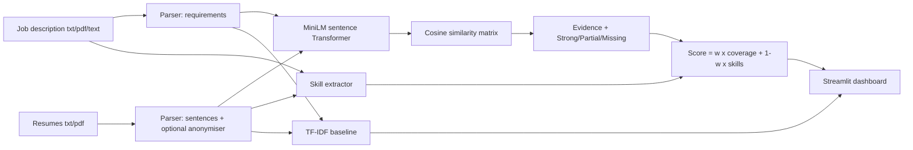

# ResumeLens: An AI-Powered Resume Screening Assistant using Sentence Transformers

## 1. Abstract
Recruiters receive hundreds of resumes per vacancy, and keyword-based filters reject qualified candidates who describe skills in different words. This project presents ResumeLens, a web application that ranks resumes against a job description using semantic similarity computed with the pretrained sentence Transformer all-MiniLM-L6-v2. The job description is split into requirements and each resume into sentences; every text is converted to a 384-dimensional embedding, and for each requirement the most similar resume sentence is retrieved as evidence and graded Strong, Partial or Missing. This requirement coverage is combined with a dictionary-based skill check into a 0-100 match score. The application also compares the Transformer with a TF-IDF keyword baseline, offers blind screening, generates interview questions for gaps, and accepts text and PDF inputs. It runs locally, needs no paid API and no model training.

## 2. Problem statement
To design an application that screens resumes against a job description more fairly and accurately than exact keyword matching, and that explains every score with evidence a human can verify.

## 3. Objectives
1. Extract requirements from a job description and sentences from resumes (text or PDF).
2. Measure meaning-based similarity using a pretrained Transformer.
3. Provide evidence-based, explainable match scores and rankings.
4. Show the advantage of semantic matching over keyword matching.
5. Support fairness through blind screening.
6. Provide a usable interactive dashboard.

## 4. Existing system and limitations
Applicant tracking systems and manual searches use exact keyword or Boolean filters. They miss synonyms ("web services" vs "REST APIs"), reward keyword stuffing, give no explanation, and manual screening is slow and inconsistent.

## 5. Proposed methodology
1. **Input:** job description and resumes (text or PDF via pypdf).
2. **Preprocessing:** split into requirements and sentences using regular expressions; optional anonymisation.
3. **Embedding:** all-MiniLM-L6-v2 converts each text into a normalised 384-dimensional vector.
4. **Matching:** cosine similarity between each requirement and every resume sentence; the best sentence is the evidence; thresholds (default 0.50 / 0.35) give Strong / Partial / Missing with credits 1 / 0.5 / 0.
5. **Skill check:** dictionary and regular-expression skill extraction; skill coverage = matched / required.
6. **Score:** final = w x requirement coverage + (1 - w) x skill coverage (w = 0.6 default), scaled to 0-100.
7. **Baseline:** TF-IDF cosine similarity for comparison.
8. **Output:** ranking, coverage matrix, evidence cards, skill gaps, interview questions, CSV export.

## 6. NLP concepts used
Sentence segmentation; tokenization (WordPiece inside the model); Transformer encoder and self-attention; sentence embeddings with mean pooling; contrastive pretraining; semantic textual similarity; cosine similarity; TF-IDF; dictionary-based information (skill) extraction; text anonymisation; bi-encoder retrieval.

## 7. Model explanation
all-MiniLM-L6-v2 is a 6-layer, 384-hidden-size BERT-style encoder (about 22 M parameters) fine-tuned with a contrastive objective on over one billion sentence pairs. Self-attention layers produce contextual token vectors; mean pooling averages them into one sentence vector. It is used as pretrained, without further training.

## 8. System architecture

## 9. Tools and technologies
Python; Streamlit; sentence-transformers; PyTorch; scikit-learn; pandas; NumPy; matplotlib; pypdf.

## 10. Implementation details
`matcher.py` holds the NLP functions; `app.py` the four-tab interface (Ranking dashboard, Candidate deep-dive, Transformer vs keywords, How it works); `skills.py` the skill dictionary (about 60 skills); `samples.py` the demo job description and four fictional candidates; `test_core.py` self-checks. Model and results are cached. If the model cannot load, the application uses a labelled keyword fallback.

## 11. Results
**Verified during development**
- The scoring logic and ranking ran correctly on the demo data in the keyword baseline mode. Under keywords only, the computer-vision candidate scored 57.7 and the NLP candidate 43.6: the baseline favours wording over relevance, which motivates the Transformer.
- The full application ran through automated interaction tests in both the keyword fallback and a Transformer code path (loaded via the SentenceTransformer API from a randomly initialised stand-in model), covering default load, blind mode, empty and malformed job descriptions, single-sentence descriptions, weight changes and upload mode with no files.
- PDF text extraction worked on generated PDFs; blank and corrupt PDFs were handled without crashing.
- The server started and passed its health check.

**To record yourself on your laptop with the real model** (do not write numbers you have not seen): the ranking and scores from `python test_core.py` and the dashboard; the similarity of the two example sentences in the "Transformer vs keywords" tab; the number of Transformer-only matches; the effect of blind mode on the scores.

**Screenshots to capture:** (1) Ranking dashboard with bar chart and coverage matrix; (2) Candidate deep-dive with evidence cards; (3) skills chips and interview questions; (4) Transformer vs keywords tab with the sentence pair; (5) blind-mode notice; (6) a PDF upload; (7) terminal after `python test_core.py`.

## 12. Advantages
Meaning-based, explainable, local and free, fast on CPU, supports PDFs, adjustable parameters, blind mode, fallback behaviour.

## 13. Limitations
Heuristic thresholds not calibrated on labelled hiring data; no formal accuracy evaluation; English only; small skill dictionary; sentence-level matching ignores multi-sentence context and years of experience; scanned PDFs unsupported; blind mode is rule-based; the model may carry bias.

## 14. Future enhancements
Fine-tune on resume-job pairs; NER for skills, education and experience duration; cross-encoder re-ranking; multilingual model; semantic search over a resume database; bias audit; export of a PDF report.

## 15. Conclusion
ResumeLens shows how pretrained Transformer embeddings can solve a practical problem: screening resumes by meaning rather than by exact words. By pairing every score with the supporting sentence and a keyword baseline, the application is transparent, usable on an ordinary laptop, and honest about its limitations.

## 16. References
1. Reimers, N., Gurevych, I. (2019). Sentence-BERT: Sentence Embeddings using Siamese BERT-Networks. EMNLP.
2. Wang, W. et al. (2020). MiniLM: Deep Self-Attention Distillation for Task-Agnostic Compression of Pre-Trained Transformers. NeurIPS.
3. Vaswani, A. et al. (2017). Attention Is All You Need. NeurIPS.
4. Devlin, J. et al. (2019). BERT: Pre-training of Deep Bidirectional Transformers. NAACL.
5. Salton, G., Buckley, C. (1988). Term-weighting approaches in automatic text retrieval.
6. Pedregosa, F. et al. (2011). Scikit-learn: Machine Learning in Python. JMLR.
7. sentence-transformers documentation: https://www.sbert.net
8. Streamlit documentation: https://docs.streamlit.io

---
# 3 to 5 Minute Demonstration Script

Prepare: run the app once so the model is cached; keep `demo_files/` open in a file window; zoom 100%.

**0:00 Problem (30 s)** "Recruiters receive hundreds of resumes per job. Keyword filters reject good people who use different words, for example 'web services' instead of 'REST APIs'. ResumeLens ranks resumes by meaning using a pretrained Transformer, and shows evidence for every score."

**0:30 Ranking dashboard (60 s)** "On the left is a job description for an NLP engineer, on the right four candidates with different backgrounds. The dashboard ranks them. The matrix shows, for each requirement, how well each resume covers it: green means a sentence with similar meaning exists." (Read the actual order and scores shown on your screen.)

**1:30 Deep-dive (60 s)** Select the top candidate. "For each requirement, the app finds the resume sentence with the closest meaning and shows it as evidence. For example [point to a requirement where the wording differs]. Skills are checked separately, and the recruiter assistant suggests interview questions for gaps."

**2:30 Transformer vs keywords (60 s)** "Here I type two sentences with different words. The keyword method gives [read value]; the Transformer gives [read value]. This is why a Transformer is the right tool." Then show the candidate comparison table.

**3:30 Blind mode and upload (45 s)** Turn on Blind screening: "names and contact details are masked before scoring." Switch to Upload my own; upload `job_description.txt` and `Meera_Iyer.pdf` plus one or two other PDFs: "It reads PDFs and ranks new candidates immediately."

**4:15 Close (30 s)** "ResumeLens uses MiniLM, a 6-layer sentence Transformer, with cosine similarity, plus a skill check. It is decision support, not a replacement for recruiters. Limitations: heuristic thresholds, English only. Future work: fine-tuning and NER. Thank you."

## Backup plan
If the model fails to load: the app shows a red banner and keyword fallback. Do not demo like that; instead run with the offline copy (README) or show screenshots.
