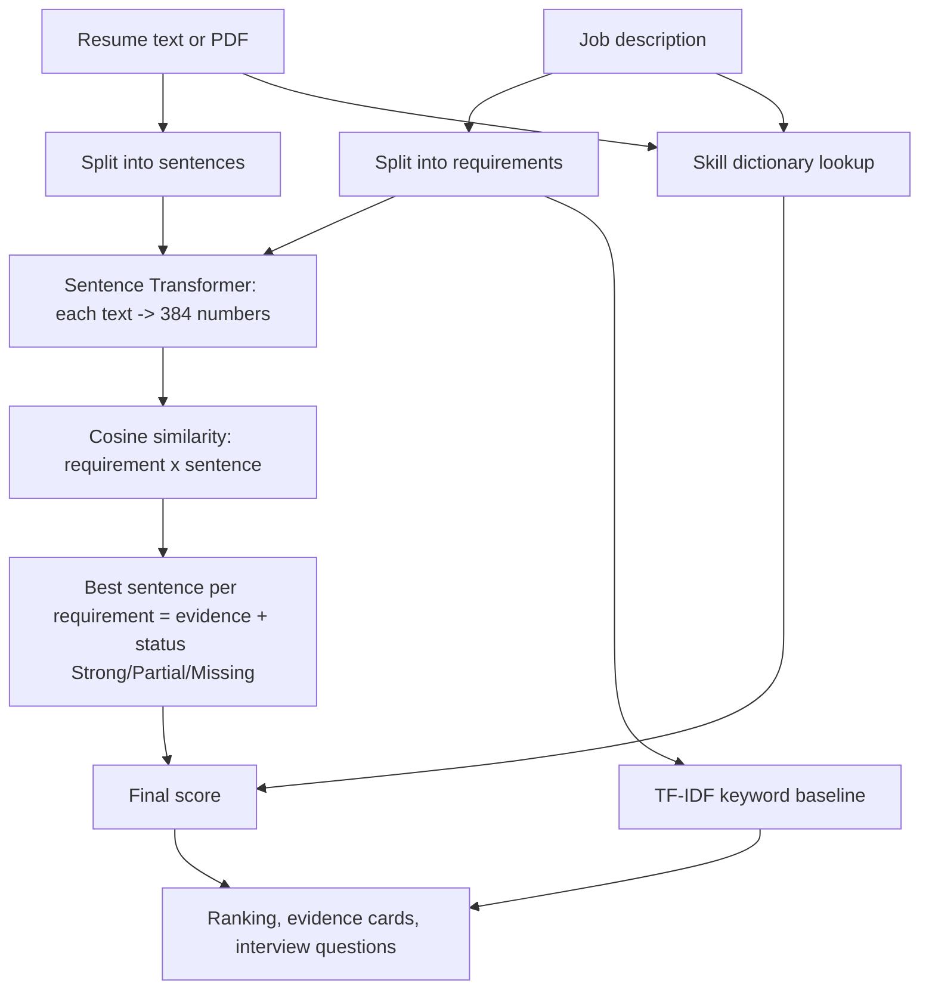

# Study Guide: understand ResumeLens

## 1. The problem and why it matters
A job posting can attract hundreds of resumes. Recruiters (and Applicant Tracking Systems) often filter by exact keywords.
Two problems: (1) a good candidate who writes "built web services" is rejected for a role that says "REST APIs";
(2) a weak candidate who copies the job-description words passes. ResumeLens ranks by **meaning** and shows the **evidence**.

**Users:** recruiters and HR teams (screening), candidates and career centres (checking how well a resume covers a job).

## 2. The big idea in one picture

## 3. Concepts
**Tokenization / embeddings** (see earlier guides): text becomes tokens, then vectors.

**Sentence embedding.** A normal Transformer gives one vector per *token*. A **sentence Transformer** adds **mean pooling**
(average of all token vectors) so one whole sentence becomes **one vector** (384 numbers here). Sentences with similar meaning
land close together. This is what lets us compare "Created web services that other teams can call" with "Build REST APIs for other teams".

**The model: all-MiniLM-L6-v2.** From the sentence-transformers library. A small BERT-style **encoder** with 6 layers and
hidden size 384 (about 22 M parameters, about 90 MB), fine-tuned on over a billion sentence pairs with a **contrastive** objective:
pairs that belong together are pulled close, other sentences in the batch are pushed apart. It uses **self-attention** inside
(the mechanism from AttentionLens), but here we use only its final sentence vector. Input beyond its maximum length (256 word-pieces by default) is cut,
which is fine for single sentences.

**Cosine similarity.** The cosine of the angle between two vectors: near 1 = same direction (same meaning), near 0 = unrelated.
We normalise vectors to length 1, so cosine = dot product (`vectors_a @ vectors_b.T`).

**Bi-encoder vs cross-encoder.** Our model encodes each text *separately* and compares vectors (fast, can pre-compute).
A cross-encoder reads both texts together (more accurate but slow: one pass per pair). For many resumes, bi-encoders are the practical choice.

**TF-IDF baseline.** Counts shared words (weighted by rarity). "web services" and "REST APIs" share no words, so TF-IDF sees almost no similarity.
This is the comparison that proves the Transformer adds value.

## 4. How the score is computed (`analyze_candidate` in matcher.py)
1. `extract_requirements`: takes the lines after a heading such as "Requirements"; each bullet with 3 or more words is a requirement.
2. `split_units`: resume -> sentences/bullets (3+ words).
3. `semantic_similarity`: matrix with one row per requirement and one column per resume sentence.
4. For every requirement take `argmax` along its row: the **best-matching sentence = evidence**.
5. Status by threshold: similarity >= strong -> Strong (credit 1); >= partial -> Partial (credit 0.5); else Missing (0).
   Defaults 0.50 and 0.35 are **heuristics** adjustable in the sidebar.
6. `requirement_score` = average credit.
7. `find_skills`: dictionary + regular expressions find skills in the JD and in the resume; `skill_score` = matched / required skills.
8. `final = w x requirement_score + (1 - w) x skill_score` (w = 0.6 by default), shown as 0-100.
9. "Transformer-only match": requirement judged Strong/Partial although the best sentence has TF-IDF similarity below 0.10 (almost no shared words).
10. Interview questions: templates filled with missing skills and missing requirements.

Why combine two signals? Semantic evidence catches meaning; the skill list gives a transparent, checkable second opinion.

## 5. Other components
* **Blind screening** (`anonymize`): regular expressions mask e-mails, phone numbers, links, and replace a short first line (the name) with [NAME]. Aim: reduce bias. It is simple and does not remove everything identifying.
* **PDF reading** (`read_uploaded_file`): `pypdf` extracts text from text-based PDFs (not scanned images).
* **Streamlit caching:** `st.cache_resource` loads the model once; `st.cache_data` caches analysis results.
* **Fallback:** if the model cannot load, `semantic_similarity` calls the TF-IDF method instead so the app still runs (clearly flagged).
* **Coverage matrix:** matplotlib `imshow` heatmap: candidates x requirements, coloured by best-match similarity.

## 6. Function map
| Function | Purpose |
|---|---|
| `load_model` | loads the sentence Transformer, returns (model, error) |
| `read_uploaded_file` | txt/pdf -> text |
| `split_units`, `clean_line` | text -> clean sentences |
| `extract_requirements` | job description -> list of requirements |
| `anonymize` | blind screening |
| `find_skills` | skill dictionary matching |
| `semantic_similarity` | Transformer cosine similarity matrix |
| `keyword_similarity` | TF-IDF baseline matrix |
| `status_of` | similarity -> Strong/Partial/Missing |
| `analyze_candidate` | full scoring of one resume |
| `verdict` | score -> Strong / Possible / Weak match |

## 7. Trace one example (Aisha, requirement R6)
Requirement: "Build REST APIs that serve models to other teams."
1. Encode it and all 9 of Aisha's sentences -> 384-number vectors.
2. Compute 9 cosine similarities. The sentence "Created web services in Flask that let other teams call our language models." should score highest.
3. If that value is >= the strong threshold it is marked Strong, and the card shows this sentence as evidence.
4. TF-IDF for the same pair is low (few shared words: "teams", "models"), so if the status is not Missing it is counted as a *Transformer-only match*.
(Exact numbers appear in your live app. I could not run the real weights while building, so do not memorise numbers; read them from the screen.)

## 7b. What I did see during development (keyword fallback, real code)
With the keyword method only, the computer-vision candidate (Daniel Roy) scored 57.7 and the NLP candidate (Aisha Khan) scored 43.6,
because Aisha uses different words for the same skills ("web services", "Amazon Web Services"). This is the weakness the Transformer is meant to fix.
Whether the Transformer ranking reverses this on your laptop is something to check with `test_core.py`; do not claim it before you see it.

## 8. Responsible-use points (professors like these)
* Decision *support*, not automatic rejection; every score is explained by evidence.
* Blind mode reduces name/contact bias, but models can still inherit biases from training data.
* Thresholds and weights are adjustable and not learned from hiring outcomes; no accuracy figure is claimed.
